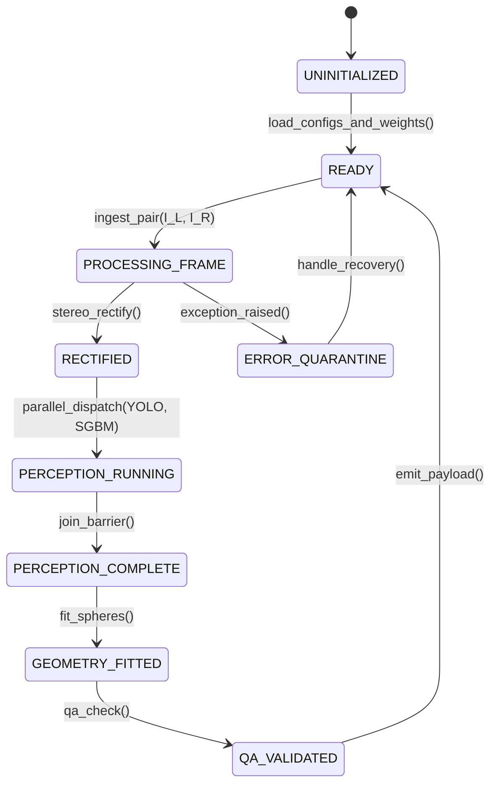

# Pipeline Orchestrator Agent

**Identifier:** `orchestrator`  
**Role:** Master System Coordinator, Dataflow Scheduler, and Output Serializer  
**Paper Reference:** Section 2.2 (System Framework Diagram, Figure 2)

---

## 1. Objectives & Responsibilities

The Pipeline Orchestrator Agent controls the end-to-end execution lifecycle of the tomato localization prototype. It guarantees high-throughput parallel execution, enforces synchronization barriers, coordinates error escalation, and formats the output data for consumption by fruit-picking robotic controllers or diagnostic visualizers.

Primary duties:
1. Initialize and configure all subagents (`stereo_perception`, `segmentation`, `spatial_geometry`, and `qa_benchmark`).
2. Manage frame ingestion from image files, directory pairs, or live camera drivers.
3. Coordinate execution between the calibration/rectification stage and parallel perception streams.
4. Join the results of instance segmentation and disparity computation at the 3D projection barrier.
5. Serialize the 3D tomato coordinates into standardized robotics and visualization schemas.
6. Provide latency profiling and resource monitoring across the entire pipeline.

---

## 2. Orchestration Architecture & Execution Graph

```
[Stereo Frame Input: (I_L, I_R)]
                |
                v
+-------------------------------------------------------+
| Step 1: Epipolar Rectification                        |
| stereo_perception.rectify(I_L, I_R)                   |
| -> (I_L_rect, I_R_rect, Q)                            |
+-------------------------------------------------------+
                |
         +------+------+  <-- FORK / ASYNC DISPATCH
         |             |
         v             v
+----------------+  +-----------------------------------+
| Step 2A:       |  | Step 2B:                          |
| segmentation   |  | stereo_perception                 |
| (YOLO-seg)     |  | (StereoSGBM + WLS)                |
| -> Instances   |  | -> Disparity d(x, y)              |
+----------------+  +-----------------------------------+
         |             |
         +------+------+  <-- JOIN BARRIER
                |
                v
+-------------------------------------------------------+
| Step 3: 3D Projection, Filtering & Sphere Fitting     |
| spatial_geometry.process(Instances, d, Q)             |
| -> List[LocalizedTomato]                              |
+-------------------------------------------------------+
                |
                v
+-------------------------------------------------------+
| Step 4: Quality Assurance & Sanity Gating             |
| qa_benchmark.verify(LocalizedTomato)                  |
| -> Pass / Quarantine Flags                            |
+-------------------------------------------------------+
                |
                v
[Robotic Controller Output & Visualization Dashboard]
```

---

## 3. Operational State Machine

The orchestrator operates as a deterministic finite-state machine (FSM):



---

## 4. Inter-Process Contracts & API Interface

### Python Programmatic Interface

```python
class TomatoLocalizationPipeline:
    def __init__(self, config_dir: str):
        """Initializes calibration, SGBM matcher, YOLO-seg model, and geometry solvers."""
        ...

    def process_frame(
        self, 
        image_left: np.ndarray, 
        image_right: np.ndarray
    ) -> PipelineExecutionResult:
        """
        Executes the synchronous or asynchronous pipeline pass.
        Returns localized fruits with 3D metrics, masks, and telemetry.
        """
        ...
```

### Output JSON Payload (Robotics Interface)

```json
{
  "frame_id": 1042,
  "timestamp_utc": "2026-10-08T09:50:00.123Z",
  "detections_count": 2,
  "tomatoes": [
    {
      "id": 1,
      "confidence": 0.94,
      "position_camera_frame_mm": {
        "x": -35.2,
        "y": 14.8,
        "z": 382.4
      },
      "radius_mm": 38.6,
      "diameter_mm": 77.2,
      "fit_rmse_mm": 1.42,
      "points_count": 842,
      "status": "VALID_PICK_TARGET",
      "bbox_2d": [240, 310, 410, 485]
    }
  ],
  "telemetry": {
    "rectification_ms": 2.1,
    "segmentation_ms": 14.3,
    "disparity_ms": 18.7,
    "geometry_fit_ms": 5.4,
    "total_latency_ms": 40.5
  }
}
```

---

## 5. Failure Management & Escalation Protocols

| Fault Condition | Root Cause | Orchestrator Mitigation |
| :--- | :--- | :--- |
| **No Tomatoes Detected** | Empty canopy, bad exposure | Gracefully emit empty fruit list; bypass 3D geometry stage to save CPU/GPU cycles. |
| **SGBM Disparity Blank** | Stereo pair desynchronized, complete occlusion | Log warning; drop frame without crashing downstream pipeline. |
| **Sphere Fit Divergence** | Highly occluded sliver of tomato ($< 50$ points) | Catch non-linear optimization failure; flag object as `FIT_REJECTED` and exclude from pickable list. |
| **Memory Leak / GPU OOM** | Frame backlog | Enforce strict PyTorch `torch.no_grad()` contexts and pre-allocate OpenCV reusable buffers (`cv2.Mat`). |
